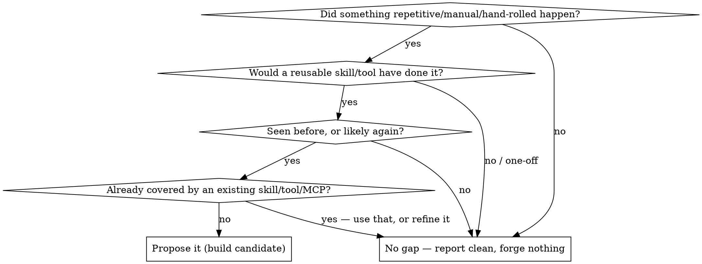

# Skill-Forge

Turn a session's capability gaps into reusable skills/tools, then keep them sharp with real usage. This skill **proposes**; the maintainer **disposes** on any build or retire. It never force-builds a skill to look productive — most scans should surface **zero** gaps, and that is the correct, healthy outcome. Skill sprawl is the failure mode this guards against.

**Kill switch:** if `~/.claude/.forge-off` exists, decline — do nothing, say the forge is off.

**Not the same loop as your lessons-capture step.** A lessons loop captures *lessons* (what we learned) → a lessons doc (e.g. `docs/solutions/` or a `LESSONS.md`). Skill-forge builds *capabilities* (a thing that does work) → a skill/tool + a ledger entry. If the takeaway is "remember to do X," that is a lesson (your lessons-capture step). If it is "I kept doing X by hand and want a reusable doer," that is a forge candidate.

## Modes

Pick the mode from how you were invoked. State which mode you're in.

### scan — detect gaps (wrap-up / on request)

Look back over the session (and, at wrap-up, the recent session history) for a **genuine, recurring** capability gap. Mid-project scans are valid too — scanning *before* a repeating work phase (e.g., between batches of a production loop) is often the highest-leverage moment, since a build amortizes over the remaining repetitions. Filter hard:



Gap signals: the same multi-step ritual done by hand more than once; a hand-rolled `curl`/script against an API with no clean tool; a workflow where you had to remember a fragile sequence; "I wish there were a skill for this." Before proposing, check the existing skills list and MCP surface — if one already covers it, use or **refine** it instead of forging a duplicate.

Output: for each candidate — **gap** (one line), **what the skill/tool would do**, **kind** (skill/tool/command), **why existing tools don't cover it**. If none survive the filter, say "no forge candidate this session" — and when notable near-misses were rejected, name each in one line with the test it failed (this shows the filter ran, not that the scan was skipped). Then stop. Do **not** build without the maintainer's go-ahead.

### build — forge an accepted candidate

**REQUIRED SUB-SKILL:** use `writing-skills` for authoring (frontmatter = `name` + `description`; description is **triggering conditions only**, never a workflow summary; keyword-rich for discovery). For a tool/CLI over an external API, prefer your CLI-generation tool of choice (e.g. an API-CLI generator) first.

1. Build the skill/tool per writing-skills. The `description` is the load-bearing discoverability mechanism (it decides whether the skill is invoked in future) — make it match how the scenario will actually surface. For `kind: tool` (a script in `~/.claude/bin`, no SKILL.md), writing-skills' Iron Law is `test-driven-development` on the script: a failing test first, fixtures shaped from the live data, then the smoke in step 3 against the real source — and a pointer sentence in whichever skill owns the scenario, since a bin script has no description for future-you to find.
2. Register it: append one line to `~/.claude/skill-forge/ledger.jsonl` with `name, kind, path, gap, created, last_refined, refine_threshold (default 3), status:"active"`. **Do not author the date yourself** — shell out: `date +%F`.
3. Functional smoke test: exercise it once (or a subagent application-scenario test) and confirm it does the thing. Report what you verified.

### refine — improve a skill from real usage

Triggered when a forged skill's counter reaches its `refine_threshold` (the usage hook nudges), or on request.

1. Read `~/.claude/skill-forge/usage.jsonl` filtered to that skill, plus the skill's own file, to see how it's actually been invoked and where it was awkward or missed. The log carries bare events with no mode and no outcome, so it gives you *frequency and recency*, not awkwardness. When it is thin, drive the refine from the skill's **most recent real use** — where it misfired or you fought it — not from detail the log does not carry. A clean, working skill legitimately needs no edit; do not manufacture one to satisfy the nudge.

   **The counter counts shell runs too, and the log distinguishes them.** A `Skill`-tool call logs `"event":"invoked"`; a skill whose payload is a script, driven straight from the shell, logs `"event":"ran"`. Two consequences when reading it. A skill whose payload is a script needs a threshold scaled to that unit, not the default of a few. And a shell command that merely *reads* a skill's directory counts as a use — deliberate, because using a skill without the `Skill` tool looks exactly like that from outside. The count can run slightly high, where counting tool calls alone ran catastrophically low.

   **What no counter sees is the gap that matters most.** The real signal is often not how often a skill ran, but the one-off scripts hand-rolled *around* it — each one a capability it lacked. Nothing counts those. When a skill is in heavy use, read what got written alongside it.
2. Improve the weakest thing: sharpen the `description` if it wasn't auto-invoking; fix steps that misfired; add a real rationalization/mistake seen in use; cut dead weight. Small, evidence-driven edits — not a rewrite.

   **When the evidence is a bug, reproduce it before you fix it, and re-run the reproduction after.** A fix for a behaviour you only observed once is a guess until the reproduction fails on the old version and passes on the new one. Keep the pre-refine copy (`cp` it aside) and run both — "small edit" and "verified edit" are different claims.

   The trap is a reproduction that cannot fail. A worked case, from refining a skill that waits for a pull request's CI checks: the bug was exiting 0 on a check set the host was still creating. The first fix required the check count to hold steady across polls; the first test served a *stable* partial set, so the gate accepted it and the test passed the guard by a route the real bug does not take. The second test grew the set but let the workflow-run status disagree with it — a state the host cannot produce. Only the third, with both surfaces driven off one phase counter, showed the truth: **count-stability is not a completeness signal at all** (two readings of a half-created set look exactly like two of a finished one), and the fix had to move to workflow-run status. Two tests had already "passed" against a fix that did not work.

   So: make the reproduction fail against the unmodified skill first. If it does not, the reproduction is wrong and proves nothing about the fix. And check that the states your fixture serves are ones the real system can actually be in.
3. Close the pass — all three parts, or the ledger lies. **Run the closer, do not hand-write the three writes:**
   ```bash
   ~/.claude/skills/skill-forge/close-refine <name>              # the pass changed something
   ~/.claude/skills/skill-forge/close-refine <name> --no-change  # reviewed and found clean
   ~/.claude/skills/skill-forge/close-refine <name> --dry-run    # preview the three writes
   ```
   It resets the counter, stamps `last_refined` from its own `date +%F`, and appends the event in
   the exact shape below. It refuses an unregistered or duplicated name, a retired skill, and a
   second close on a day the skill was already closed, which is the one that double-counts in the
   only log the flywheel reads. It rewrites just the one ledger line, so the rest of the file stays
   byte-identical, and swaps the ledger in atomically.

   **Reviewed and found clean closes the same way**, with `--no-change` — `last_refined` means
   "last refine pass", not "last edit". Skip it and the nudge re-fires on a skill you already
   cleared, which teaches the reader to ignore the nudge.

   The shape it writes, which is the contract if you ever have to do this by hand:
   ```
   {"name":"<name>","ts":"<date +%F>","event":"refined"}
   ```
   Compact separators, keys as given. A vaguer instruction here is why one log drifted into three
   incompatible shapes, one of them keyed on `skill`/`date` and therefore invisible to every reader
   that filters on `.name`. Note the two files disagree on style on purpose: `ledger.jsonl` is
   written with default spaced separators, `usage.jsonl` compact. Hand-closing five skills in one
   session produced a spaced event line that a `"name":"x"` grep could not match, which is the
   defect the closer exists to remove.
4. If a skill is used near-zero over a long window, or a scan found it obsolete, propose **retire** (set `status:"retired"`, note why) — surface for sign-off, don't retire silently.

### status — list the forge

Read `ledger.jsonl` + `counts/`. Print each active forged skill: name, uses-since-refine, refine_threshold, due-for-refine? Note the kill-switch state.

## Interplay with the hooks

- `skill-forge-usage.sh` (PostToolUse on `Skill`) increments `counts/<name>` and nudges at threshold. You don't call it — it feeds you.
- `skill-forge-status.sh` (SessionStart) surfaces active forged skills + refine-due, so they stay top-of-mind. Silent when the ledger is empty.
- Your session-wrap-up command/ritual should carry a scan step — that is the canonical wrap-up trigger (see the install notes for wiring it, including the requirement that the scan be invoked *through the `Skill` tool* so the usage hook can count it).

## Common mistakes

| Mistake | Fix |
|---|---|
| Forging a skill to prove the loop works | Most scans → zero. Report clean. Sprawl is the failure mode. |
| Description summarizes the workflow | Triggers only — a workflow summary makes future-you skip the body (writing-skills CSO). |
| Duplicating an existing skill/MCP | Check the skills list first; refine the existing one instead. |
| Authoring dates/counters by hand | Run `close-refine`; it shells the date and owns the counter. |
| Hand-writing the three closing writes | `close-refine` exists because doing it by hand drifted a log into three shapes and, once, a grep-invisible event line. |
| Rewriting a skill on refine | Evidence-driven small edits from `usage.jsonl`, not a rewrite. |
